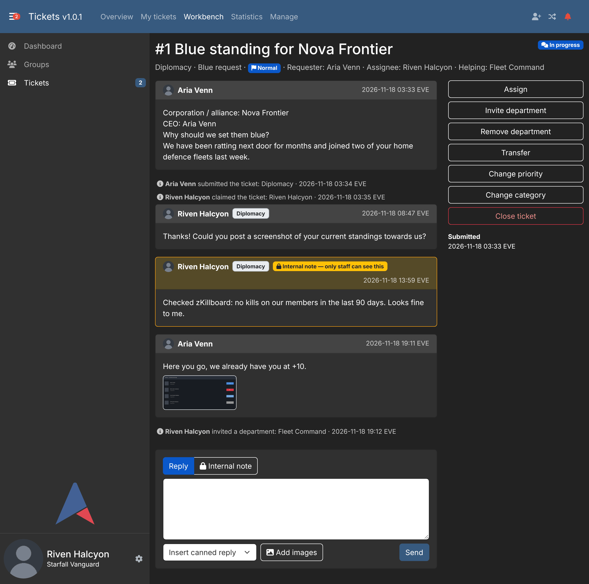
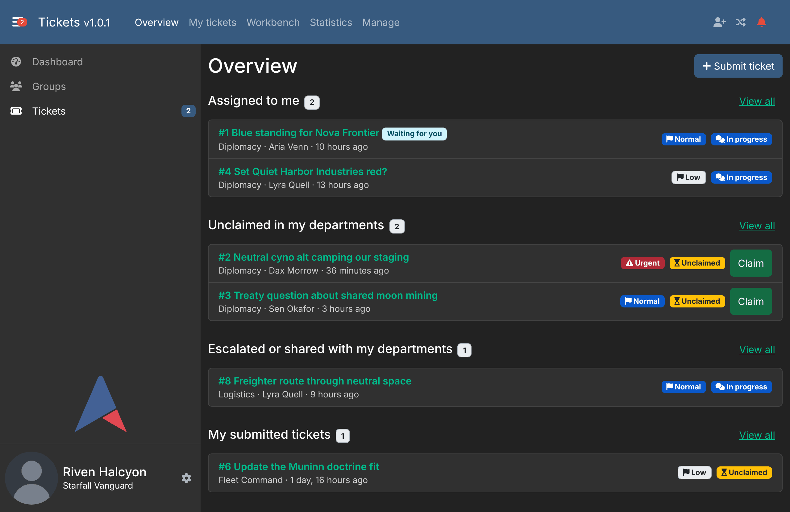
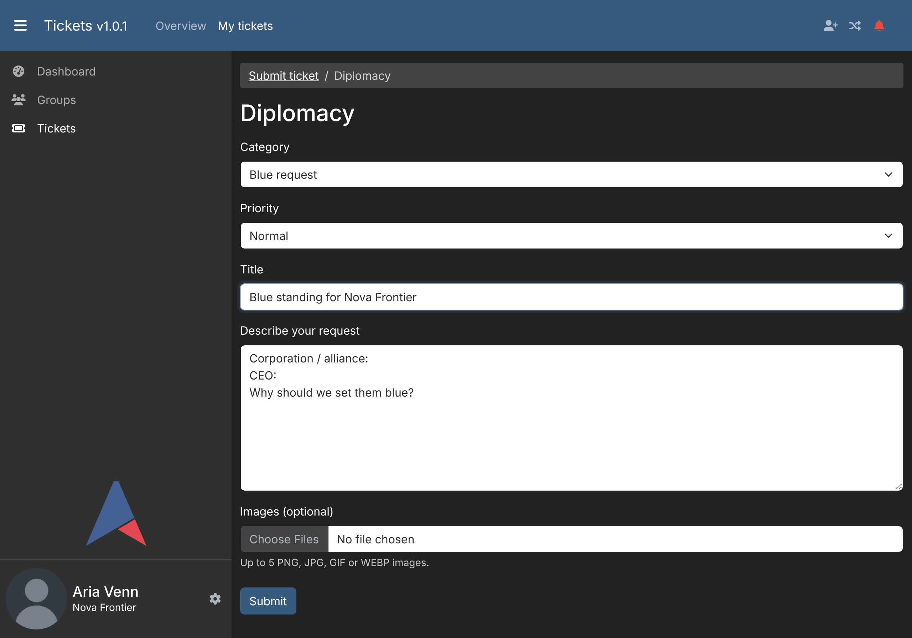
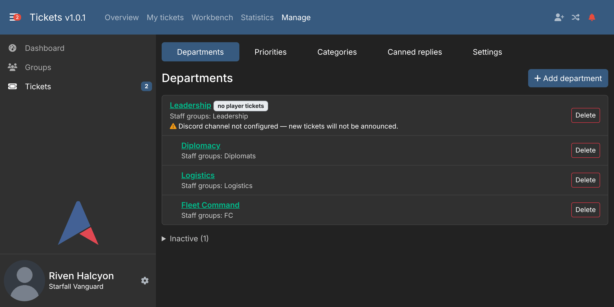
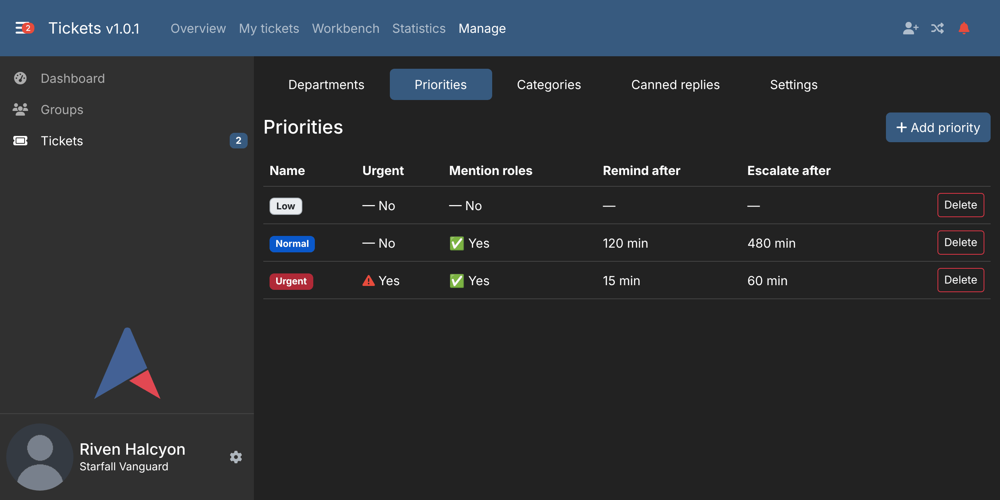

# aa-ticket

A ticket system for [Alliance Auth](https://gitlab.com/allianceauth/allianceauth).

Players submit tickets to a department, such as Diplomacy or Logistics. The department is
pinged in its own Discord channel. Staff claim the ticket in Alliance Auth, talk with the
player, bring in other departments, hand the ticket over or escalate it, and close it.
Everything is configured from the Alliance Auth front end; no code or Django admin needed.

[中文说明](README.zh-hans.md)



## Contents

- [Features](#features)
- [Screenshots](#screenshots)
- [Requirements](#requirements)
- [Installation](#installation)
- [Permissions](#permissions)
- [Setting up departments](#setting-up-departments)
- [Discord](#discord)
- [Settings](#settings)
- [How a ticket moves](#how-a-ticket-moves)
- [Data protection](#data-protection)
- [Updating](#updating)
- [Uninstalling](#uninstalling)
- [Translations](#translations)
- [Development](#development)

## Features

- **Departments with a hierarchy.** Each department has staff groups, an optional parent
  department, its own Discord webhook and roles to mention. Staff of a parent department see
  every ticket of the departments below it, but are not pinged for them.
- **Priorities you define.** Each priority sets whether new tickets mention the department's
  roles, when to remind the department if nobody claims the ticket, and when to ping the
  parent department.
- **Categories per department.** Each category can have a template that is pre-filled into the
  ticket text.
- **A conversation in Alliance Auth.** Requester and staff reply back and forth and can attach
  images. Staff can also write internal notes that the requester never sees.
- **Working together.** Staff can invite other departments, transfer the ticket to another
  department, or reassign it. Requesters can ask the department above to step in, one level
  at a time.
- **Closing.** The requester or the staff can close a ticket. A ticket that waits for the
  requester closes automatically after a set number of days, with a warning beforehand.
  Tickets waiting for staff are never closed automatically; staff are reminded instead.
- **Notifications.** Alliance Auth notifications always. With
  [aa-discordbot](https://github.com/Solar-Helix-Independent-Transport/allianceauth-discordbot)
  installed, also Discord direct messages, which each person can turn off.
- **Overview page and dashboard card.** Players see their open tickets, officers also see
  tickets assigned to them, unclaimed tickets of their departments (urgent first) and tickets
  escalated to them. A card on the Alliance Auth dashboard shows the counts.
- **Canned replies**, a **workbench** for staff and **statistics** per department.
- **Languages:** English, Simplified Chinese, German, Russian and Spanish.

## Screenshots

All names in the screenshots are made up. Theme: Darkly.

**Overview** — what is assigned to you, what is waiting in your departments (urgent first), what
was escalated or shared with you, and your own tickets.



**Submitting a ticket** — the category fills in its template.



**Departments** — parent and child departments, staff groups and a warning when no Discord
channel is set up.



**Priorities** — per priority: ping the role or not, reminder and escalation times.



## Requirements

- Alliance Auth 5.0 or newer (tested with 5.4.0). On Alliance Auth 5.0 and 5.1 also install
  `django-sri<1`; newer django-sri versions break Alliance Auth's own templates there.
- Python 3.10 or newer
- Celery and Celery Beat running, as for every Alliance Auth install
- Optional: aa-discordbot, for Discord direct messages

## Installation

### 1. Install the package

With your Alliance Auth virtual environment active:

```bash
pip install git+https://github.com/yilifaer/aa-ticket.git@v1.0.1
```

### 2. Change `local.py`

Add the app:

```python
INSTALLED_APPS += ["aa_ticket"]
```

Images are stored in `MEDIA_ROOT`. Alliance Auth does not set it by default. Pick a folder
the web server user can write to:

```python
MEDIA_ROOT = "/home/allianceserver/myauth/media/"
```

The daily `cleanup_attachments` task also removes image files that no ticket refers to any more
(for example after a failed upload); it leaves files younger than one day alone.

Without `MEDIA_ROOT` the app still works, but image uploads are turned off and
`python manage.py check` shows the warning `aa_ticket.W001`. The same command shows
`aa_ticket.W003` if one of the three periodic tasks below is missing, and `aa_ticket.W004` if
`SITE_URL` is not set (links in Discord messages need it; Alliance Auth's `local.py` normally
sets it).

**Do not serve `MEDIA_ROOT` publicly** from your web server (no `location /media/` that
points to it for this folder). Images are delivered only through the app's
permission-checked page.

Your web server must accept uploads of a few MB. nginx allows only 1 MB by default; add this to
the Alliance Auth `server` block and reload nginx:

```nginx
client_max_body_size 32m;
```

This fits five images at the largest allowed size (6 MB each, see *Maximum image size*).

Add the periodic tasks:

```python
CELERYBEAT_SCHEDULE["aa_ticket_check_unclaimed"] = {
    "task": "aa_ticket.tasks.check_unclaimed",
    "schedule": crontab(minute="*/5"),
}
CELERYBEAT_SCHEDULE["aa_ticket_check_auto_close"] = {
    "task": "aa_ticket.tasks.check_auto_close",
    "schedule": crontab(minute="*/15"),
}
CELERYBEAT_SCHEDULE["aa_ticket_cleanup_attachments"] = {
    "task": "aa_ticket.tasks.cleanup_attachments",
    "schedule": crontab(minute=17, hour=3),
}
```

The app never creates periodic tasks by itself.

### 3. Migrate, collect static files, restart

```bash
python manage.py migrate
python manage.py collectstatic --noinput
```

Then restart Alliance Auth and its Celery workers (for example
`supervisorctl restart myauth:`).

The migrations create three priorities, *Low*, *Normal* and *Urgent*, in the app's own
table. You can rename, change or deactivate them.

## Permissions

The app adds three permissions. It does not give them to anyone; you decide.

| Permission | Who should get it | What it does |
|---|---|---|
| `aa_ticket.basic_access` | Everyone who may submit tickets (for example the Member state) **and all department staff** | Shows the menu, lets the person submit tickets and see their own tickets |
| `aa_ticket.view_all` ("Can view and handle all tickets") | Top leadership, if you want them to see every ticket (they also need `basic_access`) | Sees all tickets, including internal notes and images, and can act on them like the parent of every department. Is never pinged |
| `aa_ticket.manage` | Ticket administrators (they also need `basic_access`) | Opens all *Manage* pages: departments, priorities, categories, canned replies of every department, settings. Whoever can change departments can also decide who reads which tickets, so give it only to people you would also give `view_all` |

Without `basic_access` nobody sees the app, whatever else they have. Department staff can manage
the canned replies of their own departments without `manage`.

Department staff are not set by a permission. They are the members of the groups you link
to a department (see below).

**Use closed groups for department staff.** Anyone who can join a staff group can read all
tickets of that department and the departments below it, including internal notes. Do not
use open, requestable or auto-assigned groups as staff groups. The department list shows a red
warning for groups that anyone can join or request, and for corporation or alliance groups that
Alliance Auth fills automatically ("autogroups"). A group's *states* setting only limits who may
join and is not a problem on its own.

**Superusers** pass every permission check in Django, so they have `view_all` and `manage`.
They are not staff of any department unless they are in a department's group, so they are
not pinged and do not see the *Unclaimed* badge.

**Changes to permissions and groups show up with a short delay** on the dashboard card (up to
30 seconds) and in the menu badge (up to 60 seconds), because both are cached. The ticket pages
themselves check permissions on every request.

## Setting up departments

Open **Tickets → Manage → Departments → Add department**.

| Field | Meaning |
|---|---|
| Name, description | Shown to players when they choose a department |
| Parent department | Staff of the parent see all tickets of this department. Leave empty for a top department |
| Staff groups | Members of these Alliance Auth groups are staff of this department |
| Accepts tickets from players | Turn off for departments that only receive transfers or escalations, such as *Leadership* |
| States / groups allowed to submit | Optional. Leave both empty to let everyone with `basic_access` submit. If every state and group you picked is later deleted, nobody can submit to this department (it does not open up to everyone) and the department list shows a red warning; tick *Let everyone submit again* on the department page to open it |
| Discord webhook | The channel where this department is pinged. See [Discord](#discord) |
| Discord role IDs to mention | The roles pinged for new tickets, depending on the priority |
| Active | Inactive departments disappear from all choices. Existing tickets stay |

A department that still has tickets or sub-departments cannot be deleted. Deactivate it
instead.

A typical setup:

```
Leadership           (CEO group, does not accept tickets from players)
├── Diplomacy        (Diplomats group)
├── Logistics        (Logistics group)
└── Recruitment      (Recruiters group)
```

The CEOs then see every ticket but are only pinged when a ticket is escalated to them.

**Check the priorities before adding webhooks.** The app comes with three priorities: *Low*,
*Normal* (mentions the roles for new tickets, reminds after 24 hours) and *Urgent* (mentions the
roles, reminds after 30 minutes, escalates after 2 hours). As soon as a department has a webhook
and role IDs, pings and reminders start. Change them under **Manage → Priorities**.

## Discord

### Webhook

In Discord: **Channel settings → Integrations → Webhooks → New Webhook → Copy Webhook URL**.
Paste the URL into the department's *Discord webhook* field and save. Then open the department
again and press **Send test message**.

The webhook URL is never shown again in full. Leave the field empty to keep it, or tick
*Remove the webhook* to delete it.

### Role IDs

In Discord: **User settings → Advanced → Developer Mode** on. Then **Server settings →
Roles**, right-click the role, **Copy Role ID**. Several IDs are separated by commas.

### What is posted to the channel

| Event | Channel | Roles mentioned |
|---|---|---|
| New ticket | Responsible department | If the priority says so |
| Transferred in | New department | If the priority says so |
| Invited to help | Invited department | If the priority says so |
| Requester adds a reply to an unclaimed ticket | Responsible department | Never (at most once an hour per ticket) |
| Requester asks for escalation | Department above | Always |
| Still unclaimed | Responsible department | Always |
| Still unclaimed, escalation time reached | Department above | Always |
| Requester waits for staff too long | Responsible department | Never |
| Assignee left the department, ticket is unclaimed again | Responsible department | Never |

Every channel message and direct message ends with a small footer line (always English):
`This was a Ticket Bot Notice from <sender> to <recipient> at 2026-11-15 11:03:28 EVE`. The
sender is the person who caused it, or `Alliance Auth` for new tickets and automatic messages.

Replies are never posted to the channel. Messages contain the ticket number, title,
department, category, priority, requester and a link, **never the ticket text**, because
not everyone in the channel may be allowed to read it. Only the configured roles can be
mentioned; `@everyone` and `@here` in a ticket title do nothing.

If Discord refuses a message, the app retries a few times and then shows
"Last delivery failed" on the department page.

Channel messages use the *Language of Discord channel messages* setting (English by default).

### Personal notifications

The requester gets an Alliance Auth notification when staff reply, when the ticket is claimed,
assigned, transferred, closed or reopened, when its priority is changed, and before it closes
automatically. The assignee is notified when the requester or a colleague replies, when the
requester closes, reopens or asks for escalation, and when they are assigned a ticket. Nobody is
notified about their own action.

### Direct messages (optional)

If aa-discordbot is installed and *Discord direct messages* is on in the settings, people
get the same notifications as Discord direct messages. Each person can turn this off under
**Tickets → Preferences**.

A person does not get direct messages if they have not linked Discord in Alliance Auth,
are not on your Discord server, or do not allow direct messages from server members. Their
Alliance Auth notifications still arrive.

aa-discordbot needs its Celery route in `myauth/celery.py`:
`"aadiscordbot.tasks.*": {"queue": "aadiscordbot"}`. Without it, no app can send direct
messages and the worker log shows "This function should be called asynchronously".

Direct messages use each person's language from their Alliance Auth profile, or the channel
language, depending on the *Language of Discord direct messages* setting.

## Settings

**Tickets → Manage → Settings**

| Setting | Default | Meaning |
|---|---|---|
| Auto-close after (days) | 7 | Tickets waiting for the requester close after this many days without a reply |
| Warn before auto-close (hours) | 24 | Requester and assignee are warned this long before. `0` turns the warning off. Must be shorter than the auto-close time |
| Requester can reopen for (days) | 7 | Staff can always reopen |
| Open tickets per person | 5 | A person cannot open more tickets than this at once |
| New tickets per person per hour | 5 | Stops one person from submitting (and pinging a department) over and over. `0` means no limit |
| Maximum image size (MB) | 5 | Up to 5 images per message; PNG, JPG, GIF and WEBP. At most 6 |
| Delete images after (days) | empty | Images of tickets closed longer than this are deleted. Empty keeps them |
| Discord direct messages | on | Only has an effect when aa-discordbot is installed |
| Language of Discord channel messages | English | English, Simplified Chinese, German, Russian or Spanish |
| Language of Discord direct messages | each person's own | Each person's profile language, or the channel language |

## How a ticket moves

```
Submitted ──► Unclaimed ──claim──► In progress ──close──► Closed
                  ▲                    │                    │
                  └──── transfer ──────┘◄────── reopen ──────┘
```

- **Claim:** staff of the responsible department or any department above it.
- **Reply:** only the requester and the current assignee can reply publicly. Everyone else
  on the staff side writes internal notes, or claims / assigns the ticket to themselves first.
- **Invite department:** the invited department can read the ticket and write internal notes.
  Replying to the requester stays with the assignee.
- **Transfer:** the new department becomes responsible and the ticket goes back to
  *Unclaimed*. By default the old department keeps helping.
- **Request escalation:** the requester asks the department above to step in. The next request
  goes one level higher. Each level can be asked once.
- **Auto-close** only applies when the last reply came from staff. If the requester replied
  last and staff stay silent, the assignee and the department are reminded instead.
- A requester who is also staff of the department still cannot see internal notes on their
  own ticket and cannot claim it.
- If the assignee leaves the department's staff groups, they lose access at once and the
  ticket goes back to *Unclaimed* within five minutes; the department channel is notified.

## Data protection

The app stores, per ticket: the requester's user account and main character, the text of
all replies and internal notes, uploaded images, who claimed, transferred and closed the
ticket, and when. Nothing is sent outside your server except the Discord messages described
above. Channel messages contain the ticket title, department, priority, category, the
requester's main character name and the main character name of the person who caused the
message; direct messages also contain the department and the assignee. Messages already sent to
Discord cannot be recalled.

The Discord webhook URLs are stored in plain text in the database (and therefore in your
backups). Anyone who has one can post to that channel. The app never shows them in full; if one
leaks, delete the webhook in Discord and paste a new one.

Images are served only through a permission-checked page, never from a public URL. Uploads are
re-encoded, which removes location, camera and other metadata; images with a longer edge above
4096 pixels are scaled down to 4096 pixels, and images above 25 megapixels, and animations above 25 megapixels across all
frames, are refused (decoding
larger PNG images needs too much memory on small servers such as a Raspberry Pi). Use
*Delete images after (days)* to remove old images automatically. Superusers can delete single
messages or images in the Django admin.

Tickets are kept as a record: a user who has submitted tickets cannot be deleted in Alliance
Auth while those tickets exist. Deactivate the user instead, or erase their ticket data first.

**Erasing one person's data** (for example after a data protection request). Back up the
database first; erasing cannot be undone.

```bash
python manage.py aa_ticket_erase_user <username>        # shows what would happen
python manage.py aa_ticket_erase_user <username> --yes  # erases
```

Deactivate the account first and wait a few minutes, so Discord messages still in the queue are
sent; the command refuses to erase an active account. The command deletes the tickets the person submitted, with their
images. In other tickets their messages show *Deleted user*, in-progress tickets assigned to them
become unclaimed, and the history no longer names them (also under older main characters).
Kept: the text and images of messages they wrote in other people's tickets (they are part of
that ticket), Alliance Auth notifications, and Discord messages already sent. Afterwards the
account can be deleted in Alliance Auth.

Browsers may keep an image they have shown for up to 5 minutes.

## Updating

Read the [CHANGELOG](CHANGELOG.md) first and back up your database. Then:

```bash
pip install -U git+https://github.com/yilifaer/aa-ticket.git@<new tag>
python manage.py migrate
python manage.py collectstatic --noinput
```

Then restart Alliance Auth and Celery.

To go back to the previous version: if the CHANGELOG lists database changes for the version you
installed, first undo them with `python manage.py migrate aa_ticket <last migration of the
previous version>` (from 1.0.1 back to 1.0.0: `0005`). Then install the previous tag the same way
and restart. Going back from 1.0.1 to 1.0.0 also drops the hourly submission limit, and
departments that were closed because their allowed states or groups were deleted are open to
everyone again.

## Uninstalling

1. Remove the three `aa_ticket_*` entries from `CELERYBEAT_SCHEDULE`.
   If you plan to restore a database backup afterwards, run step 2 first; otherwise the
   restored database still contains the app's tables and a later reinstall fails.
2. Remove the tables:
   ```bash
   python manage.py migrate aa_ticket zero
   ```
3. Remove `"aa_ticket"` from `INSTALLED_APPS` and run `pip uninstall aa-ticket`.
4. Remove the app's content types and permissions:
   ```bash
   python manage.py shell -c "from django.contrib.contenttypes.models import ContentType; ContentType.objects.filter(app_label='aa_ticket').delete()"
   ```
   Do **not** use `remove_stale_contenttypes --include-stale-apps`; it also deletes data of
   other apps.
5. Celery Beat keeps a copy of the periodic tasks in the database. Delete them, otherwise the
   worker keeps receiving tasks it no longer knows:
   ```bash
   python manage.py shell -c "from django_celery_beat.models import PeriodicTask; PeriodicTask.objects.filter(name__startswith='aa_ticket_').delete()"
   ```
   (or delete the three `aa_ticket_*` rows in the Django admin under *Periodic tasks*).
6. Delete `MEDIA_ROOT/aa_ticket/` if you no longer need the images.
7. Restart Alliance Auth and Celery.

## Translations

The interface follows the language each person picks in Alliance Auth. Alliance Auth
notifications use the language stored in each person's profile. Discord channel messages use
the language chosen in the settings (English by default).

All texts use the translation context `aa_ticket`, so other apps cannot override them.

English and Simplified Chinese are maintained by the author. German, Russian and Spanish are
first versions — corrections from native speakers are very welcome. Translation files are in
`aa_ticket/locale/<language>/LC_MESSAGES/django.po`.

Text you type in the management pages (department names, categories, canned replies) is shown
as you typed it.

## Development

```bash
git clone https://github.com/yilifaer/aa-ticket.git && cd aa-ticket
python -m venv .venv && . .venv/bin/activate
pip install "allianceauth==5.4.0" httpx -e ".[test]"
redis-server --daemonize yes
python runtests.py aa_ticket -v 2
```

## License

MIT, see [LICENSE](LICENSE).
