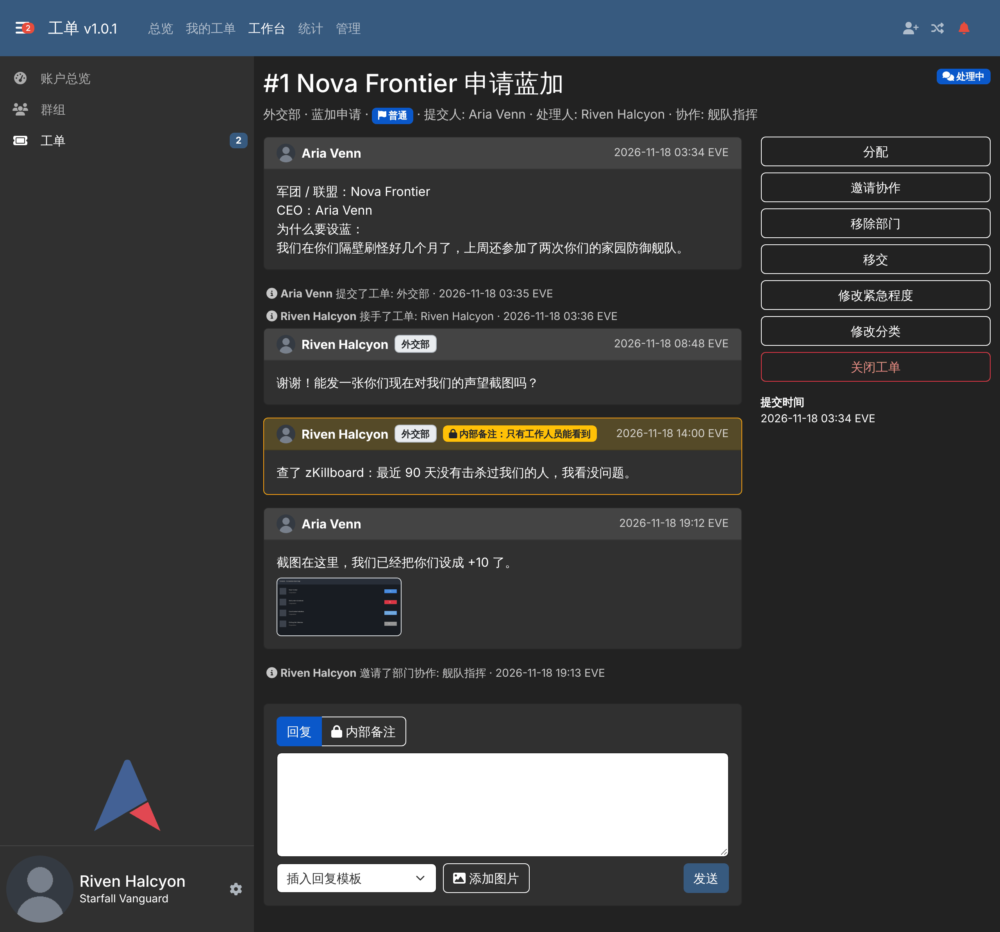
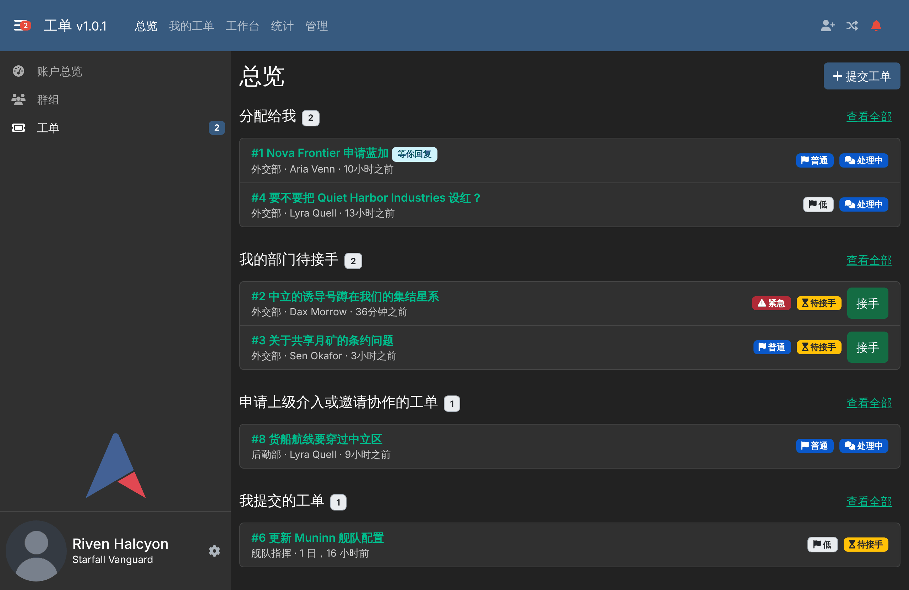
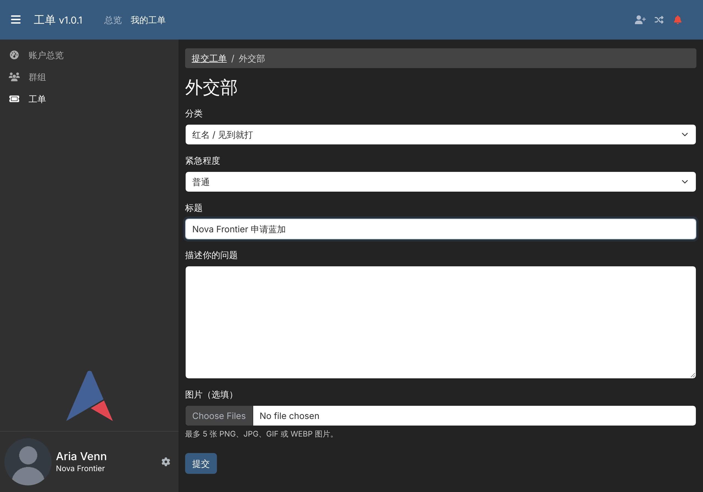
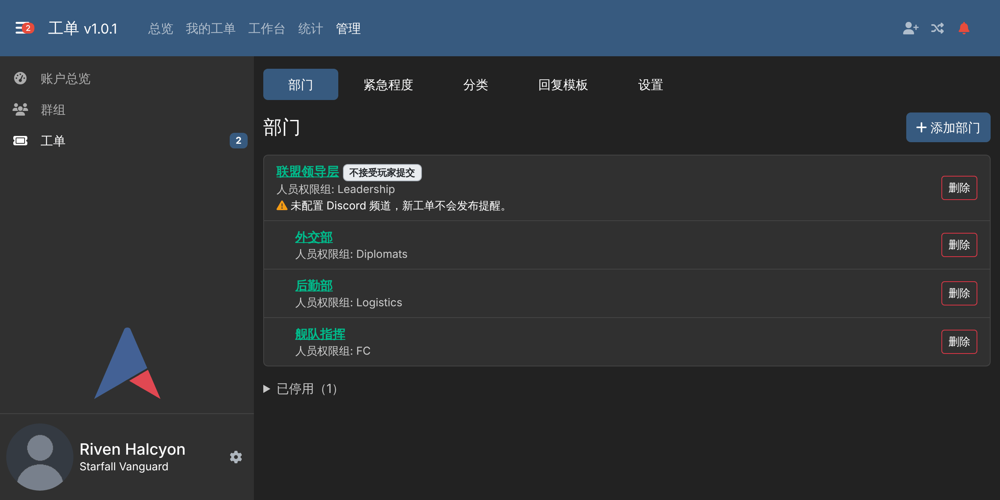
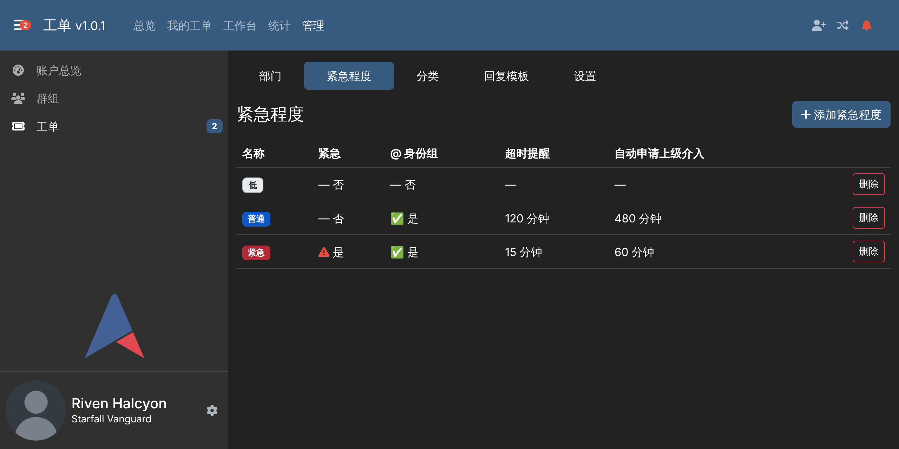

# aa-ticket

[Alliance Auth](https://gitlab.com/allianceauth/allianceauth) 的工单插件。

玩家在 AA 里提交工单，选择要找的部门（比如外交、后勤）。部门会在自己的 Discord 频道里被 @ 提醒。
工作人员在 AA 里接手工单、和玩家来回交流，可以邀请其他部门协作、移交、申请上级介入，最后关闭工单。
所有配置都在 AA 前台完成，不用改代码，也不用进 Django 后台。

[English](README.md) · [安装步骤](docs/install.zh-hans.md)



## 功能

- **部门和上下级**：每个部门绑定权限组、可以设置上级部门，并有自己的 Discord webhook 和要 @ 的身份组。上级部门能看到下级部门的所有工单，但不会被 @。
- **自定义紧急程度**：每一档可以单独设置——新工单要不要 @ 身份组、多久没人接手就再提醒一次、多久没人接手就提醒上级部门。
- **问题分类**：每个部门可以有自己的分类，每个分类可以带一份填写模板。
- **在 AA 里来回交流**：提交人和**处理人**可以公开回复、上传图片；其他工作人员要先接手（或改派给自己）才能回复提交人。工作人员还可以写**内部备注**，提交人永远看不到。
- **协作**：可以邀请其他部门加入、移交给别的部门、改派处理人。提交人可以申请上级介入，逐级往上。
- **关闭**：提交人或工作人员都可以手动关闭。等待提交人回复的工单，超过设定天数会自动关闭，关闭前会先提醒。等待工作人员回复的工单不会被自动关闭，只会提醒工作人员。
- **通知**：AA 铃铛通知一直都有。装了 [aa-discordbot](https://github.com/Solar-Helix-Independent-Transport/allianceauth-discordbot) 的话，还会发 Discord 私信，每个人可以自己关掉。
- **总览页和 AA 首页卡片**：玩家一打开就能看到自己的工单；部门人员还能看到分配给自己的、本部门待接手的（紧急的排在前面）和上报给自己部门的工单。
- **回复模板**、**工作台**、**统计页**。
- **语言**：英文、简体中文、德语、俄语、西班牙语。Discord 频道消息的语言在设置里选（默认英文）；私信可以跟随每个人的语言，也可以和频道一致。

## 截图

截图里的名字都是虚构的，主题是 Darkly。

**总览**：分配给我的、我的部门待接手的（紧急的排前面）、申请上级介入或邀请协作的、我提交的。



**提交工单**：选了分类会自动填入模板。



**部门设置**：上下级部门、人员权限组；没配 Discord 频道时会提醒。



**紧急程度**：每一档要不要 @ 身份组、多久提醒、多久自动申请上级介入。



## 安装

完整步骤（包括备份和回滚）见 [安装步骤](docs/install.zh-hans.md)。简要版：

1. `pip install git+https://github.com/yilifaer/aa-ticket.git@v1.0.1`
2. 在 `local.py` 里加上 `INSTALLED_APPS += ["aa_ticket"]`、设置 `MEDIA_ROOT`，并添加三个定时任务（写法见英文 README 的 Installation 部分）。
3. 执行 `python manage.py migrate` 和 `python manage.py collectstatic --noinput`，然后重启 AA 和 Celery。

## 权限

插件不会自动把权限给任何人，由你自己决定。

| 权限 | 给谁 | 作用 |
|---|---|---|
| `aa_ticket.basic_access` | 能提交工单的人（比如 Member 状态）**和所有部门人员** | 显示菜单、提交工单、查看自己的工单 |
| `aa_ticket.view_all`（可查看并处理所有工单） | 需要看所有工单的高层（可选；**也要有 `basic_access`**） | 能看到并处理所有工单（包括内部备注和图片），但不会被 @ |
| `aa_ticket.manage` | 工单管理员（**也要有 `basic_access`**） | 进入全部「管理」页面：部门、紧急程度、分类、所有部门的回复模板、设置。能改部门就能决定谁看哪些工单，所以只给你也愿意给 `view_all` 的人 |

没有 `basic_access` 的人，不管还有什么权限，都看不到这个插件。部门人员不需要 `manage` 也能管理自己部门的回复模板。

**部门人员不是靠权限决定的**，而是靠部门绑定的权限组。**部门的权限组必须是不公开、不能自己申请的组**，也不能是 AA 自动按军团或联盟拉人的组（autogroups），否则谁都能加进去看工单和内部备注。部门列表里会对这两种组显示红色提醒。（组的「状态」设置只是限制谁能加入，本身没问题。）

**部门的「允许提交的状态 / 组」**：两个都不选，所有有 `basic_access` 的人都能提交；选了之后，如果这些状态和组后来全被删掉，这个部门就谁都不能提交（不会变成所有人都能提交），部门列表里会显示红色提醒；要重新对所有人开放，在部门页面勾选「重新允许所有人提交」。

**加 webhook 之前先看一眼紧急程度。** 插件自带三档：低；普通（新工单 @ 身份组，24 小时没人接手再提醒）；紧急（新工单 @ 身份组，30 分钟提醒，2 小时自动申请上级介入）。部门一配好 webhook 和身份组 ID，就会开始 @ 人和提醒。在「管理 → 紧急程度」里改。

**防刷屏**：「管理 → 设置」里的「每人每小时最多提交的工单数」默认 5，填 0 就是不限制。

**超级用户**在 Django 里默认拥有所有权限，所以等同于有 `view_all` 和 `manage`。但超级用户不算任何部门的人员，除非他本人在部门的权限组里，因此不会被 @。

**改了权限或权限组之后，首页卡片和菜单上的数字会晚一点更新**：首页卡片最多 30 秒，菜单上的数字最多 60 秒（这两处有缓存）。工单页面本身每次打开都会重新检查权限，不受影响。

## Discord 会收到什么

- 新工单、移交进来、被邀请协作：发到对应部门的频道，是否 @ 身份组看紧急程度的设置。
- 申请上级介入、超时没人接手、升级到上级：一定会 @ 身份组。
- **回复不会发到频道。**
- 频道消息里只有编号、标题、部门、分类、紧急程度、提交人和链接，**不包含工单正文**。
- 玩家写的 `@everyone` 不会生效。
- 每条频道消息和私信最下面都有一行小字：`This was a Ticket Bot Notice from 谁 to 谁 at 2026-11-15 11:03:28 EVE`。新工单和自动发出的提醒写 `Alliance Auth`，有人操作的写操作人的主角色名；发给频道的写部门名，私信写收信人的主角色名。这一行固定是英文。

## 数据保护

插件会保存每张工单的：提交人账号和主角色、所有回复和内部备注、上传的图片，以及谁在什么时候接手、移交、关闭了工单。

除了上面说的 Discord 消息，不会把数据发到你的服务器以外。频道消息里有工单标题、部门、紧急程度、分类、提交人主角色名，以及触发这条消息的人的主角色名；私信里还有部门和处理人。已经发到 Discord 的消息收不回来。

**删除某个人的数据**（比如有人按隐私法要求）。先备份数据库，删了就恢复不了：

```bash
python manage.py aa_ticket_erase_user 用户名
```

先显示会删什么，确认没问题再加 `--yes` 真正删除：

```bash
python manage.py aa_ticket_erase_user 用户名 --yes
```

先在 AA 里停用这个账号，等几分钟（让排队中的 Discord 消息发完）再执行；账号没停用时命令会拒绝删除。会删掉这个人提交的工单和图片；在别人的工单里，他的回复显示为「已删除的用户」，他正在处理的工单回到待接手，记录里也不再出现他的名字（包括以前用过的主角色名）。保留的：他在别人工单里写的文字和传的图片（那是别人工单的一部分）、AA 自己的通知、已经发到 Discord 的消息。之后就可以在 AA 里删除这个账号了。

Discord webhook 地址以明文存在数据库里（所以备份里也有）。拿到地址的人就能往那个频道发消息。插件页面上从不显示完整地址；万一泄露，在 Discord 里删掉这个 webhook，再填一个新的。

图片只能通过带权限检查的页面查看，没有公开链接。上传时会去掉照片里的位置、拍摄设备等信息；长边超过 4096 像素的图片会按比例缩小到 4096 像素再保存，超过 2500 万像素的图片、所有帧加起来超过 2500 万像素的动图不收（更大的 PNG 解码时太占内存，树莓派这类小机器扛不住）。可以在设置里开启「删除图片（天）」，自动清理旧图片。

## 卸载

步骤见 [安装步骤](docs/install.zh-hans.md) 的「出问题时怎么回滚」，或英文 README 的 Uninstalling 部分。注意：

- 不要用 `remove_stale_contenttypes --include-stale-apps`，它会连带删除其他插件的数据。
- Celery Beat 会在数据库里另存一份定时任务，从 `local.py` 删掉之后还要删数据库里那 3 条 `aa_ticket_` 开头的记录，否则 Celery 会一直报找不到任务。

## 许可

MIT
